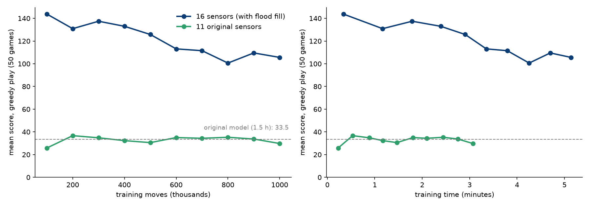

# Snake with Deep Reinforcement Learning — ללמד מחשב לשחק סנייק

סוכן **Deep Q-Learning** שלומד לשחק Snake לבד, בלי שום דוגמה של משחק "נכון". הוא לומד רק מתגמולים: ‎+10 על אוכל, ‎−10 על מוות.

📄 **דוח מלא:** [REPORT.pdf](REPORT.pdf) (או [REPORT.html](REPORT.html)): תיאוריה, כל הקבצים והפונקציות, ניסויים ותוצאות.

## תוצאות

| מודל | זמן אימון | ממוצע (500 משחקים, בלי אקראיות) | שיא |
|---|---|---|---|
| המודל המקורי (`agent.py`, 11 חיישנים) | כ-1.5 שעות | 33.5 | 84 |
| הקוד החדש, 11 חיישנים | 30 שניות | 37.8 | 77 |
| **הקוד החדש, 16 חיישנים** (`runs/feat16/best.pth`) | **20 שניות** | **145.4** | **203** |



## הרצה

```bash
pip install -r requirements.txt
python train.py                  # אימון: 64 משחקים במקביל, בלי גרפיקה (כ-5 דקות)
python train.py --view           # אותו דבר, ובנוסף מסך מפוצל עם 9 מהמשחקים
python train.py --resume runs/myrun              # המשך אימון שנעצר, מאותה נקודה (פרטים בסעיף 6)
python watch.py                  # צפייה במודל הכי טוב, מסך מפוצל 3x3
python watch.py --show 16 --fps 40
python evaluate.py               # מדידה: 500 משחקים, ממוצע, חציון, שיא וסיבת מוות
python evaluate.py --legacy model/model.pth   # מדידת המודל המקורי באותם תנאים
python compare_runs.py feat16 feat11          # גרף השוואה בין ריצות
```

כל אימון נשמר בתיקייה `runs/<שם>/`:
- `best.pth`: הרשת עם הציון הכי גבוה בהערכה.
- `last.pth`: הרשת בסוף האימון.
- `checkpoint.pth` + `checkpoint_buffer.npz`: כל מצב האימון (שתי הרשתות, האופטימייזר, הזיכרון ומונה הצעדים). נשמר בכל הערכה, בסוף האימון וגם כשעוצרים עם Ctrl+C, ו-`--resume` ממשיך ממנו.
- `log.csv`: שורה לכל משחק.
- `eval.csv`: הערכה כל 100 אלף צעדים.
- `progress.png`: גרף ההתקדמות.

## מה היה צוואר הבקבוק בקוד המקורי

1. **`clock.tick(40)`**: כל צעד חיכה לציור מסך, ולכן האימון היה מוגבל ל-**39 צעדים בשנייה**.
2. **משחק אחד**: כל צעד הביא לזיכרון דוגמה אחת בלבד.
3. **`plt.pause(0.1)`** אחרי כל משחק.
4. **`train_step`** עבר בלולאת Python על כל דוגמה והריץ את הרשת בנפרד לכל אחת.
5. **הנחש לא ידע איפה הגוף שלו** מעבר למשבצת אחת קדימה. לכן הוא נכנס לכיסים סגורים ומת. כל 500 המשחקים של המודל המקורי הסתיימו בהתנגשות בגוף.

## הפתרון

### 1. משחקים מקבילים בלי גרפיקה (`snake_env.py`)
64 משחקים רצים יחד כפעולות על מערכים של NumPy, ולא במשחק אחד עם pygame.

הלוח נשמר כמטריצה שבה כל משבצת של הנחש מחזיקה "כמה צעדים נשארו עד שהיא תתפנה":
- **צעד רגיל:** כל הערכים יורדים ב-1, והזנב מתפנה מעצמו.
- **אכילה:** לא מורידים כלום, והנחש גדל באחד.
- **התנגשות:** בדיקה אחת, `body[y, x] > 0`.

כך כל המשחקים זזים בפקודה אחת. **המהירות: 5,000–9,000 צעדים בשנייה, פי 130–220 מהמקור.** הסביבה נבדקה מול מימוש רגיל צעד אחרי צעד, 20,000 צעדים, בלי אף הבדל.

### 2. "מסך מפוצל" רק כשצריך (`split_view.py`)
הציור מופרד מהאימון. `--view` מציג כמה מהמשחקים ברשת, ומצייר רק כל כמה צעדים, כך שהאימון לא מחכה למסך.

### 3. חיישנים חדשים (16 במקום 11)
- **0–10:** 11 החיישנים המקוריים (סכנה, כיוון, מיקום האוכל).
- **11–13 (חדש):** **כמה שטח פנוי נגיש** אחרי כל אחת משלוש הפעולות (ישר, ימינה, שמאלה). החישוב הוא flood fill בעזרת `scipy.ndimage.label`, לכל המשחקים בבת אחת. הנחש "רואה" מראש שמהלך מוביל לכיס שהגוף שלו סוגר.
- **14:** רעב, כמה זמן עבר מאז האוכל האחרון.
- **15:** אורך הנחש.

### 4. DQN משופר (`dqn.py`)
- **Double DQN** עם **רשת מטרה** שמתעדכנת לאט. זה מקטין את הנטייה של DQN להעריך יתר על המידה את הערך של פעולות.
- **שתי שכבות נסתרות** (256–256), **Huber loss**, **gradient clipping**.
- **חישוב וקטורי של כל ה-batch**, בלי לולאת Python.
- **זיכרון ב-NumPy** (200 אלף צעדים).
- **ε יורד לפי צעדים, עד 0.001.** ב-0.01 מהלך אקראי אחד הורג נחש ארוך.

### 5. בחירת המודל לפי הערכה אמיתית
כל 100 אלף צעדים, 50 משחקים חמדניים (בלי אקראיות). `best.pth` נשמר לפי הציון הזה, ולא לפי ממוצע האימון, שמוטה על ידי המהלכים האקראיים.

### 6. שמירה והמשך אימון (`--resume`)
אפשר לעצור את האימון בכל רגע ולהמשיך אותו אחר כך מאותה נקודה בדיוק.

```bash
python train.py --name myrun                      # אימון חדש. עוצרים מתי שרוצים עם Ctrl+C
python train.py --resume runs/myrun               # ממשיכים מהנקודה שבה עצרנו
python train.py --resume runs/myrun --steps 3e6   # ממשיכים ומאמנים יותר ממה שתוכנן (ברירת המחדל: מיליון צעדים)
```

כשעוצרים עם Ctrl+C, האימון שומר את המצב ומדפיס את הפקודה להמשך:
```
Stopped at move 81,920. Saved to ...
uns\myrun
Continue with:  python train.py --resume runs\myrun
```

**מה נשמר:** הקובץ `checkpoint.pth`, יחד עם `checkpoint_buffer.npz` לזיכרון, מכיל את כל מה שהאימון תלוי בו:
- המשקלים של **שתי הרשתות** (הראשית ורשת המטרה).
- **מצב האופטימייזר** Adam.
- **הזיכרון** (Replay Buffer), עד 200 אלף צעדים.
- **מונה הצעדים**, ולכן ε ממשיך לרדת מאותה נקודה ולא חוזר ל-1.
- השיא, הציון הכי טוב בהערכה, הזמן שעבר, ומחוללי המספרים האקראיים.

**מתי נשמר:** בכל הערכה (כל 100 אלף צעדים), בסוף האימון, וכשעוצרים עם Ctrl+C.

**כשממשיכים:** ההגדרות של הריצה (מספר החיישנים, מספר המשחקים, lr, γ, batch) נלקחות מה-checkpoint ולא משורת הפקודה. הקבצים `log.csv` ו-`eval.csv` ממשיכים מאותה נקודה, ו-`best.pth` מתעדכן רק אם ההערכה עוברת את השיא הקודם. רק המשחקים שהיו באמצע ברגע העצירה הולכים לאיבוד, כי כל משחק מתחיל מחדש; ללמידה זה לא משנה.

**למה לא מספיק לשמור את המשקלים:** הקוד המקורי (`model.py`) שמר רק משקלים, מספר משחקים ושיא. אם ממשיכים ככה, הזיכרון ריק, האופטימייזר מתחיל מאפס ו-ε חוזר ל-1. הסוכן חוזר לשחק באקראיות, ועלול אפילו "לשכוח" את מה שלמד.

**שימו לב:**
- אם האימון כבר הגיע לסוף, `--resume` בלבד לא ימשיך. צריך להוסיף `--steps` עם מספר גדול יותר.
- הריצות `feat11`, `feat16` ו-`main` רצו לפני שהאפשרות הזו נוספה, ואין להן `checkpoint.pth`. אפשר לצפות בהן ולמדוד אותן, אבל לא להמשיך לאמן אותן.
- קבצי ה-checkpoint גדולים (עשרות MB) ולכן לא נשמרים בגיט (`.gitignore`).

## ממצאים

1. **החיישנים חשובים יותר מהמהירות.** עם 11 החיישנים, גם מיליון צעדים לא עוברים ממוצע של כ-37, כי הנחש פשוט לא יכול לראות מלכודת. עם חיישני השטח הפנוי הוא מגיע ל-**144 אחרי 100 אלף צעדים, כ-20 שניות**.
2. **המהירות קיצרה את הזמן מ-1.5 שעות ל-30 שניות** לאותה רמה של המודל המקורי (11 חיישנים).
3. **אימון ארוך יותר פגע.** עם 16 חיישנים הציון ירד מ-144 ל-105 במהלך מיליון צעדים. זו תופעה מוכרת ב-DQN (catastrophic forgetting): כשהזיכרון מתמלא במצבים של נחש ארוך, הרשת "שוכחת" חלק ממה שעבד. לכן בחירת `best.pth` לפי הערכה היא חיונית.
4. **ממוצע האימון מטעה.** בזמן האימון יש מהלכים אקראיים, ולכן הממוצע שם (כ-50) נמוך בהרבה מהיכולת האמיתית בהערכה (108–145).
5. **הגבול הנוכחי:** 94% מהמשחקים עדיין נגמרים בהתנגשות בגוף, כשהנחש ארוך מאוד (100+ על לוח של 768 משבצות).

## רעיונות להמשך
- **קלט של הלוח כולו לרשת קונבולוציה (CNN)**, במקום חיישנים שנבחרו ידנית.
- **Prioritized replay** ו-**n-step returns**.
- **learning rate יורד**, או עצירה מוקדמת לפי הערכה, נגד ההידרדרות באימון ארוך.
- **חיישן שבודק אם הזנב נגיש:** נחש שיכול לעקוב אחרי הזנב שלו לא נתקע.

## הקבצים

| קובץ | תפקיד |
|---|---|
| `snake_env.py` | סביבה וקטורית של N משחקים וחישוב החיישנים |
| `dqn.py` | רשת, זיכרון וסוכן Double DQN |
| `train.py` | אימון (`--view` למסך מפוצל, `--features 11` להשוואה, `--resume` להמשך אימון) |
| `watch.py` | צפייה במסך מפוצל |
| `evaluate.py` | מדידה, כולל המודל המקורי |
| `compare_runs.py` | גרף השוואה בין ריצות |
| `split_view.py` | ציור של כמה משחקים בחלון אחד |
| `model_select.py` | בחירת המודל הכי טוב מתוך `runs/` |
| `game.py`, `agent.py`, `model.py`, `helper.py` | **הקוד המקורי, לא שונה**, נשאר להשוואה |
